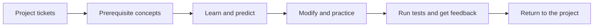

# Concept Lab

### Your next project becomes your curriculum.

**Learn what you need. Prove you understand it. Then build it yourself.**

Concept Lab turns project tickets into a personalized learning path: clear
explanations, runnable examples, output predictions, guided changes, and
independent exercises with real tests. A contextual AI tutor helps when you
get stuck.

**Open source · Local first · Your own ChatGPT account · macOS beta**

[Get started](#install-and-run) · [How it works](#the-learning-loop) · [Product direction](#where-this-can-go) · [Contribute](CONTRIBUTING.md)

## The problem

A developer picks a project, hits an unfamiliar concept, and leaves to find a
course. That course teaches a fixed syllabus. The project stalls. An AI coding
assistant can finish the ticket, but finishing the ticket does not necessarily
teach the developer how to do it again.

Concept Lab starts with the work the learner actually wants to do and builds
the lessons around the knowledge that work requires.

## The learning loop



| Step | What the learner does | Why it matters |
| --- | --- | --- |
| Learn | Read a structured explanation and edit a runnable example | Connect an idea to observable behavior |
| Predict | Trace a different program before revealing its output | Check understanding beyond copying the example |
| Modify | Change working code with progressively stronger hints | Build confidence through a focused task |
| Practice | Solve an independent exercise against multiple test inputs | Demonstrate the concept in a new situation |
| Build | Apply the prerequisites to the original project ticket | Turn practice into useful work |

The tutor sees the current lesson, code, and last execution result. Learners
control when to ask for hints or reveal a solution; a reveal is recorded as
review rather than independent practice.

## What works today

- **Tickets become a learning path.** Import Go, Python, or JavaScript project
  specifications and generate a prerequisite sequence.
- **Code actually runs.** Execute examples and grade exercises locally with
  time limits and a macOS sandbox.
- **Generated exercises are execution-checked.** Examples must run,
  predictions must match, reference answers must pass, and starters must fail
  before a lesson is saved.
- **Progress survives a restart.** Save code drafts, predictions, passed
  exercises, hints, and revealed solutions on the learner's machine.
- **Each learner connects their own account.** Eligible ChatGPT accounts power
  lesson generation and tutoring. Supplied and cached lessons run without AI
  requests.

The included **Go APIs & OAuth** project takes a complete Go beginner toward a
FHIR integration service through **34 concepts mapped to eight tickets**.
Four original foundation lessons ship with the app; additional lessons are
generated on request. The source includes **15 automated tests**, and the
app has no third-party npm dependencies.

This is a working early prototype, not a claim of validated learning outcomes
or market traction. Generated explanations still need critical review, and
passing exercise tests is evidence of a specific task, not universal mastery.

## Why this approach

**The unit of learning is the project you want to build.** The same application
can teach Go APIs today and concepts from another supported project tomorrow;
it is not limited to a fixed course catalog.

**Feedback comes from execution as well as conversation.** Learners can inspect
actual output and specific test failures, then ask for help in context.

**Learners keep their workspace.** Code, progress, and cached lessons live
locally. The application is MIT licensed and the learning flow is inspectable.
AI features use hosted models; local first does not mean fully offline.

## Where this can go

The initial audience is self-directed developers learning a new language or
stack through a real project. A possible next audience is engineering teams
helping new hires learn the concepts behind their first tickets. Both are
product hypotheses to test with early users.

The next milestones are:

- Make installation easier and add supported execution isolation beyond macOS.
- Measure whether learners can complete their project tickets independently
  and retain the concepts afterward.
- Add review sessions, clearer usage controls, and a broader curated lesson seed.
- Explore reusable onboarding paths for teams after validating the individual
  learning experience.

The current distribution is free and open source. There is no paid hosted
product today; any future commercial model would need its own product and
provider-access validation.

**Want to test it?** Bring a small project with a few concrete tickets, work
through one learning path, and share where an explanation, exercise, or hint
helped—or failed to help. See [CONTRIBUTING.md](CONTRIBUTING.md).

---

## Install and run

Install these runtimes from their official distributions or your package manager:

- [Node.js](https://nodejs.org/) 20 or newer.
- [Go](https://go.dev/dl/) 1.22 or newer.
- [Python](https://www.python.org/downloads/) 3.10 or newer.

Clone the repository and check your local setup:

```sh
git clone https://github.com/aayush7511/concept-lab.git
cd concept-lab
npm run doctor
npm start
```

Open **http://127.0.0.1:4318**. Keep the terminal running while using the app;
press Ctrl+C to stop. No `npm install` or npm packages are required. On macOS,
`start.command` is an optional launcher after the runtime setup is complete.

If port 4318 is already occupied, use `PORT=4320 npm start` and open the URL
printed in your terminal.

The runner discovers installed Go and Python from PATH. For a custom setup:

```sh
CONCEPT_LAB_GO=/absolute/path/to/go CONCEPT_LAB_PYTHON=/absolute/path/to/python3 npm start
```

An optional ignored `.local/runtimes.json` can contain `go` and `python`
executable paths. The doctor reports missing runtimes; it does not install
software. Apple's system Python shim is deliberately not invoked.

## Connect your own ChatGPT account

1. Open workspace settings and choose **Continue with ChatGPT**.
2. Sign in on OpenAI's page and review the requested plan permission.
3. Return to Concept Lab and choose a model available to your account.

Each installation creates its own host identifier and stores its own OAuth
connection. Eligible ChatGPT plans and OpenAI's current availability rules
apply. AI requests use **your** allowance; there is no shared developer key.
See [OpenAI's integration guide](https://developers.openai.com/siwc/token-sharing-open-source).

You can use the supplied lessons without connecting an account. Generating
new lessons, importing tickets with AI, and tutoring require an eligible
connection. Code execution and saved/cached lessons do not make AI requests.

## Learn, then build

The bundled Go APIs & OAuth path maps 34 concepts to eight project tickets.
Four original foundation lessons are ready immediately. Other lessons are
generated on demand and cached; generation never automatically runs the
whole course.

- **Learn:** read a structured explanation and run an editable example.
- **Predict:** trace a different program before submitting a guess. Run
  becomes available after an attempt.
- **Modify:** make a guided change, run tests, and reveal hints as needed.
- **Practice:** solve a different task checked against multiple inputs.

Progress tracks drafts, predictions, passed exercises, hints, and revealed
solutions. A solution reveal counts as review rather than independent
practice. Tutor chat history currently resets on reload.

**Import tickets** accepts Go, Python, or JavaScript project specifications,
with up to 30 tickets and 70 concepts. Paths are checked for valid prerequisite
references and ordering. Lesson examples, prediction outputs, reference
answers, and failing starters are execution-checked before saving. These
checks help catch broken exercises; they do not certify every explanation or
make the tests exhaustive.

The separate practice project is in `examples/minifhir`. After learning the
prerequisites, implement its TODOs and run its per-ticket tests. See its SPEC.md.

## Privacy, credentials, and usage

All local data is kept in `.local/`, which is ignored by Git and excluded from
release packages. It contains credentials as well as personal learning data.
**Never share that folder or upload it in a bug report.** Each friend starts
with a fresh folder and signs in independently.

OAuth tokens stay in the local Node process and owner-only credential files;
they are not exposed to browser JavaScript. The server listens on loopback
only and checks the request origin and a CSRF token for API mutations.

Ticket imports and relevant code, questions, and lesson context are sent to
OpenAI when you request AI features. Reference pages are retrieved directly
and cached. This is a local app using hosted AI, not an offline model. Manage
access and allowance from workspace settings and ChatGPT's usage settings.
Disconnect attempts remote session revocation and removes local credentials.

The app currently does not display a reliable remaining-token budget. Avoid
large generation batches if your allowance is low; reuse cached lessons and
choose an appropriate model. It will not automatically switch to API billing.

## Local execution

Go, Python, and JavaScript run using macOS `sandbox-exec`, with network access
and unrelated personal-file reads restricted. Runs have time and output
limits; temporary exercise files are removed afterward. The Go errgroup
implementation is bundled with its original license, so exercises do not need
to download dependencies. No unrestricted fallback runner is provided.

This is an early testing release, not a hardened service for executing hostile
submissions. Keep it local; do not expose its port on a public server.

## Test and contribute

```sh
npm test
```

Tests use synthetic credentials and local examples, with no live AI requests.
They cover identity validation, callback state/replay, refresh concurrency,
stream completion, curriculum validation, prediction separation, grading,
progress persistence, and sandbox restrictions. Run them from a normal macOS
terminal so the runner can apply its own sandbox.

See [CONTRIBUTING.md](CONTRIBUTING.md), [SECURITY.md](SECURITY.md), and
[THIRD_PARTY_NOTICES.md](THIRD_PARTY_NOTICES.md).

Maintainers can create a clean source ZIP with `npm run package`. The packager
uses an explicit file allowlist and excludes personal data, local overrides,
and live-request development scripts. This repository contains no account
credentials and no pre-authorized connection for another user.
