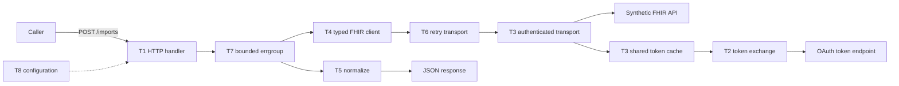
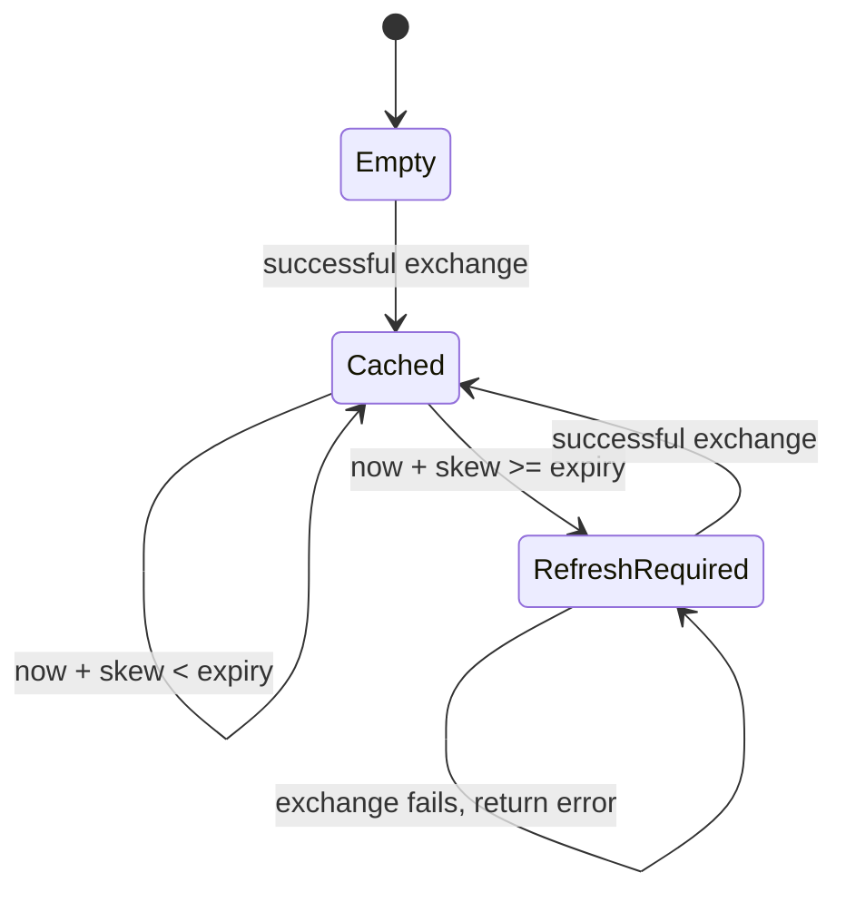

# minifhir: Go APIs & OAuth integration

You joined a healthcare integration team. Build a service that imports synthetic patient records from an OAuth-protected FHIR API into a normalized JSON model. Extract from FHIR, transform into `Patient`, and load into the HTTP response. Durable storage is a stretch goal.

The codebase, public types, interfaces, JSON helper, validation helper, server lifecycle, and mock upstream are provided. Implement the TODO regions without changing exported signatures or grader tests. Add private helpers and fields as needed. Answers live separately in `../minifhir-ANSWERS/`; leave them closed during an attempt.

This exercise intentionally uses a small FHIR subset and HTTP Basic client authentication at the token endpoint. It does not model SMART Backend Services or full FHIR validation. Client credentials have no refresh token here: “refresh” means another client-credentials exchange.

Use `make t1` … `make t8`. T1–T6 use isolated fakes and can be attempted independently; T7 needs T5, and T8 needs all preceding tickets. Expect about 4–5 hours including review. Try each cold, look things up only when blocked, and explain the interview question aloud after finishing.

## T1: Typed HTTP service · ~25 min

**File:** `internal/bridge/handler.go`

**Context:** The import endpoint is the product boundary.

**Implement:** `Handler.Routes`.

**Requirements**

- `GET /healthz`: 200 JSON. `POST /imports`: accept exactly one JSON object with `patient_ids`, reject unknown fields and trailing JSON. Limit the body to 1 MiB.
- Require 1–100 IDs; every ID must satisfy the provided `ValidID`. Validate the entire request before invoking the importer.
- Success: 200 `{"patients":[...]}`. Errors: 400 for input/ErrInvalid, 404 for ErrNotFound, otherwise 502. Use `errors.Is` and `ErrorBody`; do not expose upstream error strings.
- Use WriteJSON for application responses; the mux may use its standard 404/405 behavior.

**Trap:** A decoder can accept the first object while silently leaving another object unread.

**Interview angle:** Why return a typed error rather than an HTTP status from the pipeline?

## T2: Client-credentials exchange · ~25 min

**File:** `internal/bridge/oauth.go`

**Context:** The token endpoint is separate from the FHIR resource server.

**Implement:** `OAuth.FetchToken`.

**Requirements**

- POST form-encoded `grant_type=client_credentials`, with the request context and Content-Type header.
- Authenticate with HTTP Basic using form-escaped client ID and secret (url.QueryEscape before SetBasicAuth).
- Require 200, nonempty access_token, case-insensitive bearer token_type, and positive expires_in.
- Return errors wrapping ErrUpstream for HTTP/decode/token failures. Close response bodies. Never include secrets, tokens, or response bodies in errors.

**Trap:** A 200 response with an empty token is still a failure.

**Interview angle:** Why does this flow obtain another access token instead of using a refresh token?

## T3: Shared token cache and authentication · ~40 min

**File:** `internal/bridge/auth.go`

**Context:** Concurrent imports must share a token without a refresh stampede.

**Implement:** `TokenCache` private fields, `AccessToken`, `AuthTransport.RoundTrip`.

**Requirements**

- Cache one token and its expiry, using injected Now. Reuse only while `Now()+Skew < expiry`; equality requires refresh.
- Serialize refreshes and guard all cache state. Use a successful exchange completion time plus expires_in for expiry. A failed exchange returns its error without replacing cached state.
- Check context cancellation before using/exchanging a token. Skew is nonnegative in this exercise.
- Clone outbound requests before setting Authorization: Bearer. Default nil Base to http.DefaultTransport; propagate token-source errors.

**Trap:** Mutating a shared request header can cause both token leakage and a data race.

**Interview angle:** What tradeoff does holding a mutex during the token request make? How would you make waiters cancel promptly?

## T4: Typed FHIR client · ~25 min

**File:** `internal/bridge/fhir.go`

**Context:** Decode a bounded exercise model while tolerating unknown FHIR fields.

**Implement:** `FHIRClient.Fetch`.

**Requirements**

- Reject invalid IDs with ErrInvalid before any network call. GET `<BaseURL>/Patient/<id>` with Accept: application/fhir+json and caller context.
- 404 maps to ErrNotFound; other non-200 statuses and decode/network failures wrap ErrUpstream.
- Require resourceType Patient and a response ID matching the requested ID. Close every response body; accept extra JSON fields.

**Trap:** A successful response containing a different resource or ID must not enter the pipeline.

**Interview angle:** Why use structs for known fields while allowing unknown JSON fields here?

## T5: ETL normalization · ~30 min

**File:** `internal/bridge/transform.go`

**Context:** Keep foreign API details out of your internal model.

**Implement:** `Transform`.

**Requirements**

- Require resourceType Patient and ValidID; invalid input wraps ErrInvalid.
- Choose the first official name, otherwise the first name. Join given names then family; trim and collapse all whitespace. Missing names produce an empty full_name.
- Birth date may be empty; otherwise require a real full YYYY-MM-DD date. Partial FHIR dates are deliberately outside this exercise.
- Trim/lowercase gender; preserve male/female/other/unknown, map everything else to unknown.
- Use the first nonblank email telecom value; trim/lowercase it. Missing email is empty.
- Preserve ID, never mutate input slices, and return a zero Patient on error.

**Trap:** Appending to a borrowed given-name slice can overwrite the caller’s underlying array.

**Interview angle:** Which normalization rules are product decisions rather than FHIR guarantees?

## T6: Retries with exponential backoff · ~35 min

**File:** `internal/bridge/retry.go`

**Context:** Transient failures should recover within a fixed attempt budget.

**Implement:** `Backoff`, `RetryTransport.RoundTrip`.

**Requirements**

- Backoff = base * 2^(attempt-1); attempts below 1 mean 1. Nonpositive base means zero. Positive cap limits the delay; nonpositive cap means saturate at maximum time.Duration. Never overflow, even at attempt 10,000.
- Retry only GET network failures and statuses 429/502/503/504. Do not retry 400/401/404/500 or any other method.
- MaxAttempts includes the first call; values below 1 mean one attempt. Return the final response/error to the caller.
- Close discarded response bodies before injected Sleep(ctx,delay). Never sleep after the last attempt. Preserve the final body for the caller.
- Honor cancellation before attempts and during sleep; nil Base uses the default transport. Sleep is required configuration.

**Trap:** Closing the final body makes the FHIR decoder fail; leaving discarded bodies open leaks resources.

**Interview angle:** Why restrict automatic retries to idempotent methods? Where would jitter and Retry-After fit?

## T7: Bounded concurrent import · ~40 min

**File:** `internal/bridge/pipeline.go`

**Context:** Import multiple patients without unbounded upstream pressure.

**Implement:** `Pipeline.Import`.

**Requirements**

- Require Limit >= 1 and validate all IDs before starting work. Empty input returns a nonnil empty slice.
- Use errgroup.WithContext and SetLimit. Fetch and transform each item, never exceeding Limit active fetches.
- Preserve input order and duplicates, regardless of completion order. Store outputs by index without concurrent append.
- First nonnil worker error cancels siblings. Wait for workers before returning; return nil output and the error (preserving errors.Is), never partial results. Fetchers must honor context.

**Trap:** Collecting results in arrival order passes simple tests but violates the API contract.

**Interview angle:** Why does each goroutine writing a distinct slice index avoid a mutex?

## T8: Wire and exercise the whole service · ~35 min

**File:** `internal/bridge/app.go`

**Context:** Connect the independently tested parts into a real HTTP pipeline.

**Implement:** `New`.

**Requirements**

- Validate both URLs have http/https scheme and host, nonempty client credentials, and positive concurrency; return ErrInvalid for bad config.
- Build token HTTP client (5s timeout), one shared TokenCache (time.Now, 10s skew), AuthTransport, then outer RetryTransport (3 attempts, 50ms base, 200ms cap, Sleep).
- Build the FHIR HTTP client with 10s timeout, Pipeline, and Handler.Routes. Construction must not call upstreams.
- Run make race and use the provided mock server. The end-to-end test uses real local HTTP, injects one 503, checks normalized results, and confirms token reuse across imports.
- Main and its signal/shutdown handling are given. Explain where each error becomes an HTTP response.

**Trap:** Creating a token cache per request defeats reuse even though individual requests succeed.

**Interview angle:** Where would you add persistence, request tracing, and a total import deadline?

## Practice loop and stretch goals

1. Start the ticket timer and implement only that ticket.
2. Run make tN until green. Run make race after T3, T7, and T8 (unfinished later tickets still fail, so scope race checks with `go test -race ./internal/bridge -run '^TestT3_'` while in progress).
3. Ask “test minifhir T3” for an OA-style review: correctness, races, errors, resource cleanup, and an explanation of your choices.
4. Fix feedback in your own implementation before looking at the reference.

Stretch: inject jitter and test it deterministically; honor Retry-After; add token invalidation for one 401 replay; make token-cache waiters context-aware; persist imports idempotently; support partial FHIR dates; bound upstream response sizes; add redirect policies for external deployments.
